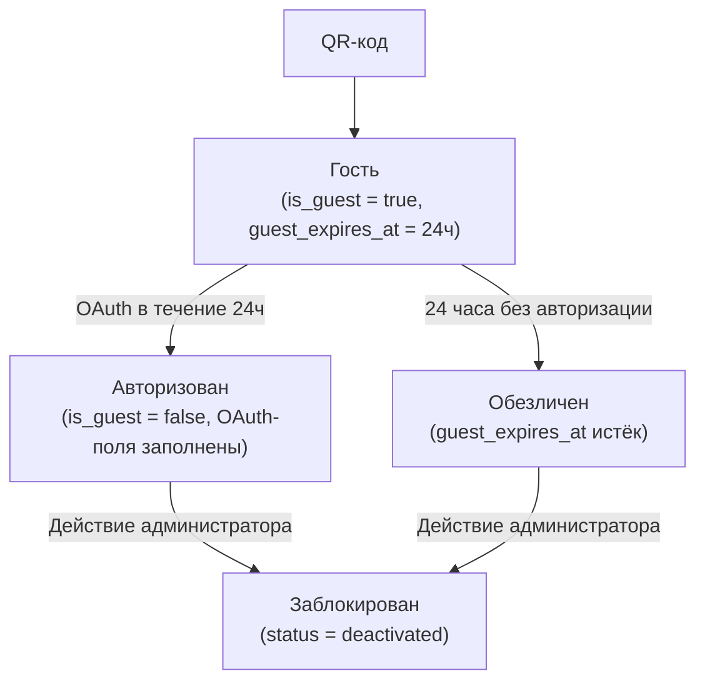

# Пользователи

Описание сущностей для работы с сотрудниками системы и пользователями платформы.

---

## StaffUser (Сотрудник системы)

Учётная запись сотрудника системы администрирования (CMS). Используется для управления доступом к функционалу платформы.

### Атрибуты

| Поле | Тип | Описание |
|------|-----|----------|
| `id` | integer (int64, автоинкремент) | Уникальный идентификатор сотрудника |
| `first_name` | string | Имя |
| `last_name` | string | Фамилия |
| `email` | string | Email для входа и уведомлений |
| `password_hash` | string | Хеш пароля |
| `role` | integer enum | `1` — admin, `2` — operator, `3` — analyst, `4` — content_editor |
| `status` | integer enum | `1` — active, `2` — blocked |
| `last_login_at` | timestamp, nullable | Дата последнего входа |
| `created_at` | timestamp | Дата создания учётной записи |
| `updated_at` | timestamp | Дата последнего обновления |

### Роли

| Роль | Код | Права |
|------|-----|-------|
| Администратор | `1` | Полный доступ ко всем разделам, управление сотрудниками |
| Оператор | `2` | Управление сценариями на планшете LED |
| Аналитик | `3` | Просмотр аналитики и отчётов |
| Контент-редактор | `4` | Управление контентом в CMS (справочники, вопросы, шаблоны, аватары, видеосценарии) |

### Список и удаление

Администратор получает список через `GET /api/staff?limit=20&offset=0`:
ответ `{items, total}`, порядок по `id`, удалённые сотрудники исключаются.
В списке возвращаются `id`, `email`, `first_name`, `last_name`, `role`, `status`.

`DELETE /api/staff/{staff_id}` физически удаляет сотрудника и возвращает `204`.
В одной транзакции сначала удаляются его refresh-токены, затем сессии авторизации
и учётная запись. Ранее выданные токены не работают; email можно зарегистрировать
повторно. Связь `auth_sessions.staff_user_id` учитывается явно; других внешних ключей
на сотрудника нет. Собственную учётную запись удалить нельзя (`409`);
отсутствующий или уже удалённый ID — `404`. Статуса DELETED нет.

### Связи

- **StaffUser** — независимая сущность, не связана с данными пользователей платформы

### Где используется

- **CMS** — управление учётными записями сотрудников, назначение ролей
- **Авторизация** — вход в CMS по email и паролю

---

## User (Пользователь платформы)

Единая учётная запись пользователя платформы. Создаётся при первом взаимодействии (сканирование QR-кода) и может быть гостевой или авторизованной в зависимости от наличия OAuth-данных.

### Атрибуты

| Поле | Тип | Описание |
|------|-----|----------|
| `id` | integer (int64, автоинкремент) | Уникальный идентификатор пользователя |
| `is_guest` | boolean | `true` — гость (не авторизован), `false` — авторизован через OAuth |
| `guest_expires_at` | timestamp, nullable | Срок действия гостевого режима (24 часа от создания). Если null — пользователь авторизован |
| `oauth_provider` | integer, nullable | Провайдер авторизации: `1` — Яндекс, `2` — VK. Null для гостя |
| `oauth_provider_id` | string, nullable | ID пользователя у провайдера. Null для гостя |
| `email` | string, nullable | Email из OAuth-провайдера |
| `first_name` | string(255), nullable | Имя из OAuth-провайдера или заданное пользователем через `PATCH /api/user/info`; при следующем OAuth-входе может обновиться данными провайдера |
| `last_name` | string(255), nullable | Фамилия из OAuth-провайдера или заданная пользователем через `PATCH /api/user/info`; при следующем OAuth-входе может обновиться данными провайдера |
| `media_id` | FK → files.id, nullable | Файл профиля: загруженный пользователем или скачанный при OAuth-входе. В API возвращается объект `file` |
| `gender` | integer, nullable | Пол: `1` — male, `2` — female, `null` — не указан |
| `birth_date` | date, nullable | Дата рождения из OAuth-провайдера |
| `status` | integer | Статус: `1` — active, `2` — deactivated |
| `created_at` | timestamp | Дата создания учётной записи |
| `updated_at` | timestamp | Дата последнего обновления |

При регистрации гостя `first_name` устанавливается в `Гость`, а `last_name` — в строковое представление его `users.id`. Например, пользователь с ID 123 получает имя «Гость 123». Пользователь может изменить эти поля через `PATCH /api/user/info`.

### Статусы пользователя

| Статус | Описание |
|--------|----------|
| `active` | Активен (независимо от способа входа — гость или OAuth) |
| `deactivated` | Заблокирован администратором: данные сохранены, вход невозможен |

### Состояния пользователя

Состояние определяется по полям `is_guest` и `guest_expires_at`:

| Состояние | Условие | Описание |
|-----------|---------|----------|
| Гость с активной сессией | `is_guest = true AND guest_expires_at > now()` | Гость может авторизоваться через OAuth |
| Обезличен | `is_guest = true AND guest_expires_at < now()` | Гость не авторизовался за 24ч, данные обезличены |
| Авторизован | `is_guest = false` | Пользователь авторизован через OAuth, поля OAuth заполнены |

### Переходы между состояниями

### Логика гостевого режима

- При первом сканировании QR-кода создаётся User со `status = active`, `is_guest = true`, `guest_expires_at` (текущее время + 24 часа)
- Все результаты (аналитика, анкеты, тесты) привязываются к `id` пользователя
- Если в течение 24 часов пользователь авторизуется через OAuth — заполняются OAuth-поля, `is_guest` устанавливается в `false` (пользователь становится авторизованным)
- Если 24 часа прошли без авторизации — `guest_expires_at` истекает, пользователь считается обезличенным (anonymized). Данные остаются в системе (аналитика не удаляется), но связать этого пользователя с будущей авторизацией нельзя

### Связи

- **User → AnalyticsEvent**: один пользователь может иметь множество событий аналитики (`user_id`)
- **User → SurveyResponse**: один пользователь может иметь множество ответов на анкеты (`user_id`)
- **User → ConsentAcceptance**: один пользователь может иметь несколько записей о принятии согласий (разные версии)
- **User → TestSession**: один пользователь может иметь множество сессий тестирования (`user_id`)
- **User → GameSession**: один пользователь может участвовать в игровых сессиях (`user_id`)

### Где используется

- **Идентификация и регистрация** — единая сущность для гостевого и авторизованного режимов
- **Цифровой профиль** — агрегация данных пользователя
- **LED-медиаплатформа** — привязка результатов сессий к пользователю
- **ПрофСтарт** — привязка результатов теста к пользователю
- **Обратная связь** — привязка ответов на анкеты к пользователю
- **Аналитика** — привязка событий к пользователю, управление учётной записью (деактивация)

### Примечания

- Единая сущность для гостя и авторизованного пользователя упрощает модель: не нужно переносить данные при привязке
- Результаты всегда привязаны к `id` пользователя, независимо от состояния (`is_guest`)
- OAuth-данные заполняются при авторизации
- Удаление аккаунта не поддерживается — только деактивация
