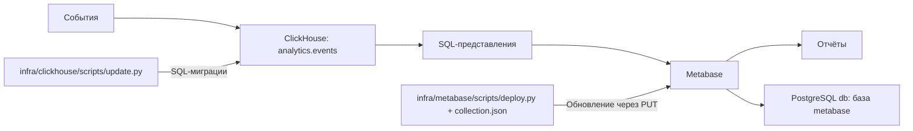

# ClickHouse и Metabase

ClickHouse хранит события в общей таблице `analytics.events`. Сейчас подключены
индивидуальная викторина и командная игра LED-медиаплатформы, а также
события рекомендаций профессий из тестов ПрофСтарт и события обратной связи. SQL-представления
рассчитывают показатели викторины. Запросы четырёх показателей
«Вовлечённости» читают общие события, включая рекомендации ПрофСтарт.
Обратная связь использует feedback_sessions и feedback_ratings, добавленные
миграцией 0004, без хранения текстовых ответов.
Metabase показывает полученные значения на графиках. Пользователи, подключения и настройки Metabase хранятся в отдельной
базе `metabase` существующего PostgreSQL проекта.

| Компонент | Compose | Хранилище |
|---|---|---|
| ClickHouse 26.9.5.2 | `clickhouse` | Том `clickhouse_data`, база `analytics` |
| Metabase 0.63.18.5 | `metabase` | База `metabase` в `db`, том `db_data` |

Образы зафиксированы по digest в `docker-compose.yml`.
Отдельный контейнер PostgreSQL для Metabase не используется.



## Структура

Пути относятся к корню backend-репозитория. Скрипты запускаются через `docker compose exec api python`;
ClickHouse и Metabase имеют независимые команды и блокировки.
История SQL-миграций ClickHouse и реестр ID Metabase хранятся локально и исключены из Git.
Все секреты находятся в едином корневом `.env`.

```text
infra/
├── config.py
├── runtime.py
├── clickhouse/
│   ├── scripts/update.py
│   └── migrations/*.sql
├── metabase/
│   ├── config.json                   # подключение, без паролей
│   ├── scripts/
│   │   ├── deploy.py
│   │   ├── client.py
│   │   └── initialize_database.py
│   └── collections/
│       └── analytics/
│           ├── collection.json
│           ├── main/
│           │   ├── collection.json
│           │   └── attendance/collection.json
│           ├── summary/collection.json
│           ├── details/
│           │   ├── collection.json
│           │   └── led-platform/
│           │       ├── collection.json
│           │       ├── common/collection.json
│           │       ├── screensaver/collection.json
│           │       ├── individual/collection.json
│           │       └── team/collection.json
│           └── insights/collection.json
└── tests/

storage/infra/                        # вне Git
├── clickhouse/
│   ├── backup/                       # резервные копии ClickHouse
│   ├── log/                          # ошибки SQL и HTTP
│   ├── versions.json
│   └── .update.lock                   # на время обновления
├── metabase/
│   ├── backup/                       # дампы и снимки Metabase
│   ├── log/                          # ошибки API, запросов и PostgreSQL
│   ├── state.json
│   └── .update.lock                   # на время обновления
└── common/
    ├── backup/                       # общие архивы изменений инфраструктуры
    └── log/                          # общая диагностика
```

Служебные файлы разделены по компонентам: дампы и архивы — в `backup`,
диагностика — в `log`. Файлы, относящиеся к нескольким компонентам, хранятся
в `storage/infra/common`. Служебные файлы исключены из Git; `storage` также исключён из контекста сборки Docker.

В примере показана часть дерева. В каждой из 26 папок коллекций есть свой
`collection.json`; папки повторяют иерархию Metabase. Родитель задаётся постоянным
ключом в JSON, поэтому перемещение файла между папками само по себе не меняет
родителя в Metabase.

## Настройки подключения Metabase

`infra/metabase/config.json` описывает подключение Metabase к ClickHouse:
имя, движок, адрес `clickhouse:8123`, базу `analytics`, пользователя
`analytics_reader` и имя переменной с паролем `CLICKHOUSE_READER_PASSWORD`.
В `settings` задан часовой пояс отчётов `Europe/Moscow`.
Файл хранится в Git и не содержит паролей или ID текущей установки.

При развёртывании скрипт использует существующее подключение из реестра или
находит его по имени; отсутствующее подключение создаёт. Уже созданное подключение
по этому файлу не обновляется. Настройки из `settings` задаются только при отсутствии
значения в Metabase. Изменение `config.json` не выполняет смену паролей или
параметров существующего подключения автоматически.

## ClickHouse: миграции

```bash
docker compose exec api python infra/clickhouse/scripts/update.py --plan
docker compose exec api python infra/clickhouse/scripts/update.py
docker compose exec api python infra/clickhouse/scripts/update.py --verify
```

Команда выполняет новые миграции по порядку и после успеха сохраняет номер
и SHA-256 в `storage/infra/clickhouse/versions.json`. На новой установке журнал
создаётся автоматически с версии 0. `--plan` показывает текущую версию и список
неприменённых файлов без подключения к ClickHouse. `--verify` применяет новые
миграции, если они есть, затем проверяет таблицу и представления.
Уже применённые файлы не менять: изменение оформить следующей миграцией.
LF/CRLF не считаются изменением содержимого.

Миграции именуются `NNNN_description.sql`, нумеруются подряд с `0001`; описание
содержит строчные латинские буквы, цифры и подчёркивания. Новую физическую таблицу
создавать отдельной миграцией; заполнение данными отделять от схемы.

Начальные миграции создают текущую схему на новой установке. Изменение исходного
DDL само по себе не преобразует существующую таблицу: `CREATE IF NOT EXISTS`
оставляет её структуру прежней. Журнал должен соответствовать фактически
применённой схеме; контрольные суммы не исправляют вручную для обхода ошибки.
Установке с другой схемой требуется проверенное преобразование данных.

SQL-файл не выполняется одной транзакцией. После ошибки часть операций может
быть применена; миграция должна допускать повтор, например через `IF NOT EXISTS`
или `CREATE OR REPLACE VIEW`. Версия увеличивается только после успеха всего файла.

## Metabase: обновление объектов

Каждый `collection.json` описывает одну коллекцию: её ключ и родителя,
сохранённые вопросы, дашборды, расположение графиков и привязки фильтров.
Запуск для выбранного файла:

```bash
docker compose exec api python infra/metabase/scripts/deploy.py analytics/details/led-platform/individual/collection.json --plan
docker compose exec api python infra/metabase/scripts/deploy.py led.individual --verify
```

Обновление всего набора и отдельная проверка запросов:

```bash
docker compose exec api python infra/metabase/scripts/deploy.py --all --plan
docker compose exec api python infra/metabase/scripts/deploy.py --all --verify
docker compose exec api python infra/metabase/scripts/deploy.py --verify
```

Существующие коллекции, вопросы и дашборды обновляются через `PUT`.
Их ID, `entity_id`, права и внешние ссылки сохраняются. Новые объекты создаются
через `POST`. Раскладка обновляется с сохранением ID существующих размещений.
Ручные изменения полей и раскладки, заданных в JSON, заменяются декларацией файла.
Дочерние коллекции и посторонние сохранённые отчёты не удаляются.
Удаление вопроса из раскладки убирает его с дашборда; сам сохранённый вопрос и его
связь в реестре остаются. Удаление файла не удаляет объекты Metabase автоматически.

Для нового графика добавить вопрос в `cards`, затем сослаться на его `key`
в `dashboards[].cards`. `dataset_query` задаёт запрос, `display` — тип графика,
`visualization_settings` — настройки. Для заготовки без SQL использовать
`placeholder`; такой виджет не создаёт сохранённого вопроса.
Ключи уникальны в пределах типа объекта. При переименовании сохранять ключ:
скрипт изменит название существующего объекта, сохранив его ID.
Поле `database` вопроса ссылается на ключ подключения из `config.json`;
пароль берётся из `.env` через `password_env` и не записывается в JSON.

Одиночная команда использует существующие вопросы соседних коллекций.
Если нужный новый вопрос отсутствует в уже развёрнутой соседней коллекции,
сначала обновить её файл. `--all` обновляет коллекции с вопросами перед общими
дашбордами. На пустой установке зависимости создаются автоматически.

### Реестр связей

`storage/infra/metabase/state.json` хранит:

- `objects`: соответствия ключей и ID подключений, коллекций, вопросов и дашбордов;
- `placements`: ID размещений графиков на каждом дашборде;
- `revision`: время сохранения;
- `metabase_url`: публичный адрес из `MB_SITE_URL` или локальный адрес с `METABASE_PORT`.

Файл создаётся автоматически. Реестр сохраняется атомарной заменой после
подтверждённых операций API. Постоянные ключи хранятся в `objects`. При отсутствии записи в реестре
объект находится по точному пути коллекции и названию, его ID сохраняется.
Несколько совпадений считаются ошибкой. После первого развёртывания постоянные
ключи связываются с ID в реестре, поэтому переименование сохраняет эти связи.

API Metabase не предоставляет общую транзакцию: при сбое часть обновлений уже
может быть применена. Исправить ошибку и повторить команду с тем же файлом.
Сохранённые ID и поиск созданных объектов по пути предотвращают повторное создание
при потере ответа API. Не менять имена и ключи во время незавершённого создания.
Каждый компонент использует собственный `.update.lock` в `storage/infra`: второй
запуск с тем же каталогом состояния отклоняется. Разные checkout должны обращаться
к одному каталогу состояния этой установки; отдельные копии не разделяют блокировку.
Сохранённые ID относятся к одной установке Metabase; для другой установки нужен её собственный реестр.

### Справочник для фронтенда

`GET /api/analytics/catalog` возвращает словари `collections`, `dashboards`,
`charts`, общий `metabase_url` и `revision`. В каждом словаре ключ проекта связан
с `id`, `url` веб-интерфейса и `api_url` описания объекта Metabase.
Запрос пока доступен без авторизации. Пароли, токены и внутренние поля реестра
не возвращаются. Бэкенд читает файл в отдельном потоке, без запроса к Metabase;
при отсутствии или повреждении реестра возвращает 503.

```json
{
  "revision": "2026-10-14T12:00:00+00:00",
  "metabase_url": "https://analytics.example.org",
  "collections": {},
  "dashboards": {
    "led.individual": {
      "id": 101,
      "url": "https://analytics.example.org/dashboard/101",
      "api_url": "https://analytics.example.org/api/dashboard/101"
    }
  },
  "charts": {}
}
```

ID в примере условный. Compose монтирует каталог `storage/infra` в API
с правом записи для скриптов. Обработчик справочника только читает файл.
Монтируется каталог, чтобы атомарная замена файла была видна контейнеру.
Все экземпляры API должны читать один актуальный реестр. Изменения файла видны
при следующем запросе, перезапуск для обычного обновления реестра не требуется.

Фронтенд получает описание по `api_url`, результаты вопроса — через
`POST /api/card/{id}/query`. Для графика в контексте дашборда:
`POST /api/dashboard/{dashboard_id}/dashcard/{dashcard_id}/card/{card_id}/query`.
Актуальный `dashcard_id` и привязки фильтров брать из ответа дашборда.
Текстовые заготовки не входят в `charts` и запросы данных для них не выполняются.

Авторизация Metabase отдельная: справочник ссылок не выдаёт доступ к данным.
Фронтенд использует сессию пользователя Metabase; административные пароли и
общие служебные API-ключи в браузер не передаются. Для запросов с одного origin
reverse proxy может направлять `/metabase/` непосредственно в Metabase;
публичный URL указывается в `MB_SITE_URL`. При отдельном origin настроить CORS
на proxy только для разрешённого фронтенда.

## Коллекции и подключённые показатели

Иерархия повторяет [дашборды административного портала](../../interfaces/admin-portal/dashboards.md):

```text
Аналитика
├── Главный Dashboard
│   ├── Посещаемость
│   ├── Вовлечённость
│   ├── Обратная связь
│   ├── Востребованность профессий
│   ├── Востребованность работодателей и учебных заведений
│   └── Тепловая диаграмма
├── Сводная аналитика по ПАК
│   ├── Общие показатели
│   ├── Сравнительные метрики
│   ├── Таблица сравнения
│   └── Дополнительно
├── Детальная аналитика по каждому ПАК
│   ├── LED-медиаплатформа
│   │   ├── Общие показатели
│   │   ├── Заставка
│   │   ├── Индивидуальная викторина
│   │   └── Командная игра
│   ├── ПрофСтарт
│   ├── Аватар профессий
│   ├── Древо профессий
│   ├── Интерактивная карта региона
│   ├── Профбаттл
│   └── Обратная связь
└── Автоматическая генерация выводов
```


Набор описывает 26 коллекций и 22 дашборда. Запросы различают игры по
`module_id=1` (индивидуальная) и `module_id=2` (командная); соединения используют
`software_id`, `module_id`, `session_id`. Подключены 34 SQL-запроса:
21 для викторины и командной игры, четыре для
[«Вовлечённости»](dashboards/general.md#вовлечённость) и девять графиков
[обратной связи](surveys.md) без текстовых комментариев.
Остальные 85 показателей представлены текстовыми
карточками-заготовками с названием и видом визуализации, без вопроса и запроса.
Они не вычисляют показатели и не показывают фиктивные значения.

| Учётная запись | Назначение |
|---|---|
| ClickHouse `analytics_admin` | Миграции и управление правами |
| ClickHouse `analytics_writer` | INSERT в `analytics.events` |
| ClickHouse `analytics_reader` | SELECT на `analytics.*`, `readonly=2` |
| PostgreSQL `metabase` | Владелец своей базы, без административных прав |
| Администратор Metabase | Вход в веб-интерфейс и развёртывание через API |

Контракт событий описан в [AnalyticsEvent](../../entities/analytics.md).
Период отчётов викторины выбирает игры по старту, конец даты включителен;
часовой пояс — `Europe/Moscow`, устройство — числовой ID.

## Единый .env

Все параметры находятся в корневом `.env`, единственный шаблон — `.env.example`.
Настройки ClickHouse и Metabase передаются через `environment`; значения берутся
из общего `.env`.
Рабочий `.env` сохраняют и дополняют, не заменяя шаблоном.

### ClickHouse

| Параметр .env | Как заполнять |
|---|---|
| `CLICKHOUSE_USER` | `analytics_admin` |
| `CLICKHOUSE_PASSWORD` | Пароль администратора ClickHouse |
| `CLICKHOUSE_DEFAULT_ACCESS_MANAGEMENT` | `1` для создания ограниченных пользователей |
| `CLICKHOUSE_WRITER_PASSWORD` | Пароль `analytics_writer` |
| `CLICKHOUSE_READER_PASSWORD` | Пароль `analytics_reader` |
| `CLICKHOUSE_PORT` | HTTP-порт на loopback сервера: `8124`; внутри Docker — `8123` |
| `ANALYTICS_CLICKHOUSE_URL` | `http://clickhouse:8123` в сети Compose |
| `ANALYTICS_CLICKHOUSE_USER` | `analytics_writer` |
| `ANALYTICS_CLICKHOUSE_PASSWORD` | `${CLICKHOUSE_WRITER_PASSWORD}`, ссылка на тот же секрет |

Скрипты проверяют формат трёх паролей ClickHouse: **64 строчных hex-символа**.
Использовать разные пароли и заполнить их вручную в общем `.env`. Скрипты
не генерируют пароли и не подставляют значения по умолчанию.

### Metabase

| Параметр .env | Как заполнять |
|---|---|
| `MB_DB_TYPE` | `postgres` |
| `MB_DB_HOST` | `db`, PostgreSQL проекта |
| `MB_DB_PORT` | `5432` |
| `MB_DB_DBNAME` | `metabase`, отдельная служебная база |
| `MB_DB_USER` | `metabase`, её владелец |
| `MB_DB_PASS` | Пароль роли PostgreSQL; не пароль входа в браузере |
| `MB_ANON_TRACKING_ENABLED` | `false` |
| `JAVA_TIMEZONE` | `Europe/Moscow` |
| `METABASE_PORT` | HTTP-порт на loopback сервера: `3001`; внутри Docker — `3000` |
| `MB_SITE_URL` | Публичный HTTPS URL; для локального доступа можно оставить пустым |
| `METABASE_ADMIN_EMAIL` | Email администратора веб-интерфейса и API |
| `METABASE_ADMIN_PASSWORD` | Его пароль |

Создание служебной базы поддерживает `db:5432/metabase` с ролью `metabase`.
Скрипт использует уже заданные `POSTGRES_HOST`, `POSTGRES_PORT`, `POSTGRES_USER`
и `POSTGRES_PASSWORD` проекта для прямого административного подключения к `db:5432`.
При изменении этих параметров адаптировать `initialize_database.py`.

Все обязательные параметры из таблиц, а также `ANALYTICS_ENABLED`, должны быть
явно заполнены в `.env`. Compose передаёт их в `api` через `env_file: .env`; скрипты
читают окружение контейнера: при отсутствии или пустом
значении выводят имена переменных, при неверном формате — ошибку соответствующего
параметра. Значения секретов не выводятся. Порты проверяются на диапазон 1–65535,
булевы флаги — на `true`/`false`, пароли ClickHouse — на формат hex, пароль отправителя
должен совпадать с `CLICKHOUSE_WRITER_PASSWORD`. `MB_SITE_URL` остаётся необязательным.
На существующей установке использовать прежние пароли.
Изменение `.env` не меняет пароли в ClickHouse, PostgreSQL или Metabase:
смена выполняется отдельно с согласованным обновлением сохранённых подключений.

## Развёртывание на другом сервере

Нужны checkout проекта, заполненный корневой `.env` и Docker с Compose.
Python и зависимости уже находятся в образе `api`; устанавливать их на хост не нужно.
Код `infra` подключён в `api` только для чтения, а `storage/infra` — с правом записи.
Скрипты подключаются к `http://clickhouse:8123`, `http://metabase:3000` и `db:5432`
в сети Compose. `MB_SITE_URL` остаётся адресом для браузера и ссылок справочника.
Скрипты не запускают Docker и не управляют жизненным циклом контейнеров.

На новой установке сначала подготовить обычный API и работающий PostgreSQL проекта,
затем ClickHouse и служебную базу Metabase; после этого запускать Metabase:

```bash
docker compose up -d api
docker compose exec api python infra/clickhouse/scripts/update.py --check-env
docker compose up -d --no-deps clickhouse
docker compose exec api python infra/clickhouse/scripts/update.py --verify
docker compose exec api python infra/metabase/scripts/initialize_database.py
docker compose up -d --no-deps metabase
docker compose exec api python infra/metabase/scripts/deploy.py --init
```

На существующей установке работающие сервисы повторно запускать не нужно.
При изменении Compose-монтирований или `.env` обновить только `api` командой
`docker compose up -d --no-deps api`, предварительно проверив миграции бэкенда:
его штатный запуск выполняет `alembic upgrade head`.

`--check-env` проверяет окружение, полученное из `.env`, без изменения файлов
и подключений к базам. Такой режим доступен у обоих компонентов. Перед запуском вручную
дополнить общий `.env` параметрами из `.env.example`; пустые секреты в шаблоне
являются местами для заполнения, а не рабочими значениями.
`--init` Metabase проверяет/подготавливает базу, подключение и реестр существующих объектов.
Содержимое JSON-деклараций при этом не применяется.
На новой установке администратор создаётся из `.env`.
После подготовки развернуть нужные файлы коллекций отдельными командами,
например индивидуальную викторину и командную игру:

```bash
docker compose exec api python infra/metabase/scripts/deploy.py led.individual --verify
docker compose exec api python infra/metabase/scripts/deploy.py led.team --verify
```

Команды одинаковы для PowerShell и Linux. Для планирования и проверки нужны
работающие целевые сервисы; скрипты не запускают и не перезапускают их.

Проверить доступность с учётом своих портов:

```bash
curl -fsS http://127.0.0.1:8124/ping
curl -fsS http://127.0.0.1:3001/api/health
```

## Вход с другого компьютера

По умолчанию оба сервиса опубликованы на `127.0.0.1` сервера.
Для входа использовать SSH-туннель:

```bash
ssh -N -L 3001:127.0.0.1:3001 user@server.example.org
```

Открыть `http://localhost:3001`, войти с `METABASE_ADMIN_EMAIL` и
`METABASE_ADMIN_PASSWORD` из `.env`. При занятом локальном порте использовать
`-L 3002:127.0.0.1:3001` и `http://localhost:3002`.
Правый порт туннеля — `METABASE_PORT` сервера.
Открыть «Аналитика» → «Детальная аналитика по каждому ПАК» → «LED-медиаплатформа».
Внутри — общий дашборд и коллекции отдельных режимов игры. Для просмотра
текущего ID основной коллекции выполнить `docker compose exec api python infra/metabase/scripts/deploy.py analytics --plan`.
Её адрес: `http://localhost:3001/collection/<ID>`; порт взять из `.env`.

Для домена настроить HTTPS reverse proxy: upstream на хосте —
`http://127.0.0.1:3001`, в общей сети Docker — `http://metabase:3000`.
Передавать `Host` и `X-Forwarded-Proto`. В общем `.env` указать
`MB_SITE_URL=https://analytics.example.org`. Значение используется Metabase и
скриптом внутри `api`; после проверки миграций бэкенда обновить окружение обоих
контейнеров и публичный URL в реестре:

```bash
docker compose up -d --no-deps api
docker compose up -d --no-deps metabase
docker compose exec api python infra/metabase/scripts/deploy.py --init
```

После этого открыть домен и войти с теми же данными.

## Резервные копии и перенос

| Что сохранять | Что восстанавливается |
|---|---|
| База `metabase` в PostgreSQL | Пользователи, права, подключения, вопросы, дашборды и настройки |
| Данные `clickhouse_data` | События и схема аналитики |
| Корневой `.env` | Пароли и параметры |
| `storage/infra/clickhouse/versions.json` | История применённых SQL-миграций |
| `storage/infra/metabase/state.json` | Ключи, ID объектов и размещений той же установки Metabase |

Файлы коллекций создают описанные отчёты, но не переносят все пользовательские
отчёты, учётные записи и настройки. Для переноса целой установки нужны копии баз.
Журнал ClickHouse и реестр Metabase сохранять вместе с данными той же установки.
Не использовать её state.json для другого сервера с независимо созданной базой Metabase.

Согласованная копия базы Metabase без остановки PostgreSQL:

```bash
mkdir -p storage/infra/metabase/backup
docker compose exec -T db sh -c 'pg_dump -U "$POSTGRES_USER" -d metabase -Fc -f /tmp/metabase.dump'
task_db_container="$(docker compose ps -q db)"
docker cp "${task_db_container}:/tmp/metabase.dump" storage/infra/metabase/backup/metabase.dump
```

Для переключения сервера зафиксировать момент переноса настроек, остановив
только Metabase. Дамп, `.env`, журнал ClickHouse и реестр Metabase передавать по защищённому каналу.
ClickHouse сохранять отдельно его средствами резервного копирования.

На новом сервере при работающих `api` и `db` создать служебную базу, не запуская Metabase:

```bash
docker compose exec api python infra/metabase/scripts/initialize_database.py
docker compose exec -T db sh -c 'psql -X -U "$POSTGRES_USER" -d metabase -v ON_ERROR_STOP=1' <<'SQL'
SELECT count(*) AS table_count FROM pg_tables WHERE schemaname = 'public';
SQL
```

Ожидается `table_count = 0`. Если таблицы есть, не восстанавливать поверх них.
В новую пустую базу:

```bash
task_db_container="$(docker compose ps -q db)"
docker cp storage/infra/metabase/backup/metabase.dump "${task_db_container}:/tmp/metabase.dump"
docker compose exec -T db sh -c 'pg_restore -U "$POSTGRES_USER" -d metabase --role=metabase --no-owner --no-privileges --exit-on-error --single-transaction /tmp/metabase.dump'
docker compose exec api python infra/clickhouse/scripts/update.py --verify
docker compose up -d --no-deps metabase
docker compose exec api python infra/metabase/scripts/deploy.py --init
```

После восстановления сначала проверить вход и сохранённые отчёты.
Не запускать развёртывание коллекций для простой проверки переноса:
оно обновляет поля и раскладку по текущим файлам проекта.

## Ограничения текущего варианта

События доставляются из памяти процесса API: авария, переполнение очереди или
исчерпание повторов могут приводить к потере данных. В коде есть счётчики
доставленных и потерянных событий; отдельный мониторинг этих счётчиков не подключён.

Резервные копии создаются вручную. Каталоги `backup` задают место хранения,
но не запускают резервное копирование по расписанию. Срок хранения событий
автоматически не ограничен: TTL в текущей таблице не задан.

Compose запускает API с `--reload` для разработки. Для рабочего сервера нужен
запуск без автоматической перезагрузки при изменении исходников.

## Диагностика

| Признак | Что проверить |
|---|---|
| `Applied migration changed` | Исходное содержимое SQL-миграции; изменение оформить следующим файлом |
| Ошибка вопроса Metabase | `storage/infra/metabase/log`; часть PUT могла выполниться, исправить файл и повторить команду |
| Справочник API отвечает 503 | Наличие и корректность state.json, монтирование storage/infra и метаданные публичного URL |
| `Ambiguous Metabase object` | Дубли названий в одном пути при восстановлении реестра; проверить соответствия ID |
| Metabase не открывается снаружи | SSH-туннель или HTTPS proxy |
| Предлагается первичная настройка | Подключение к нужной базе `metabase` |
| Осталась блокировка после аварии | Убедиться, что updater завершён; удалить только `.update.lock` нужного компонента |

Изолированные тесты скриптов и справочника используют временные файлы
и фиктивные подключения, без обращения к рабочим базам:

```bash
docker compose exec api python -m unittest discover -s infra/tests -v
```

Секреты, локальное состояние, дампы и приватную диагностику не публиковать.
