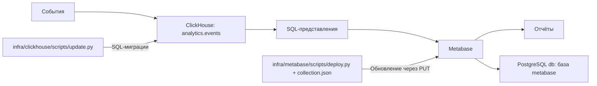

# ClickHouse и Metabase

ClickHouse хранит события в общей таблице `analytics.events`. Сейчас подключены
индивидуальная викторина и командная игра LED-медиаплатформы, а также
события старта, ответов, завершения, прерывания и рекомендаций ПрофСтарт,
а также события обратной связи. Четыре представления миграции 0006 и 13 SQL-вопросов
подключают [графики ПрофСтарт](dashboards/pak-detail/profstart.md); возраст пока отложен. SQL-представления
рассчитывают показатели викторины, обратной связи и ПрофСтарт. Запросы четырёх показателей
«Вовлечённости» читают общие события, включая рекомендации ПрофСтарт.
Обратная связь использует feedback_sessions и feedback_ratings, добавленные
миграцией 0004, без хранения текстовых ответов.
Metabase показывает полученные значения на графиках. Пользователи, подключения и настройки Metabase хранятся в отдельной
базе `metabase` существующего PostgreSQL проекта.

| Компонент | Compose | Хранилище |
|---|---|---|
| ClickHouse 26.9.5.2 | `clickhouse` | Том `clickhouse_data`, база `analytics` |
| Metabase 0.63.18.5 | `metabase` | База `metabase` в `db`, том `db_data` |

Образы зафиксированы по digest в `docker-compose.yml`.
Отдельный контейнер PostgreSQL для Metabase не используется.



## Структура

Пути относятся к корню backend-репозитория. Скрипты запускаются через `docker compose exec api python`;
ClickHouse и Metabase имеют независимые команды и блокировки.
История SQL-миграций ClickHouse и реестр ID Metabase хранятся локально и исключены из Git.
Все секреты находятся в едином корневом `.env`.

```text
infra/
├── config.py
├── runtime.py
├── clickhouse/
│   ├── scripts/update.py
│   └── migrations/*.sql
├── metabase/
│   ├── config.json                   # подключение, без паролей
│   ├── scripts/
│   │   ├── deploy.py
│   │   ├── client.py
│   │   └── initialize_database.py
│   └── collections/
│       └── analytics/
│           ├── collection.json
│           ├── main/
│           │   ├── collection.json
│           │   └── attendance/collection.json
│           ├── summary/collection.json
│           └── details/
│               ├── collection.json
│               └── led-platform/
│                   ├── collection.json
│                   ├── common/collection.json
│                   ├── screensaver/collection.json
│                   ├── individual/collection.json
│                   └── team/collection.json
└── tests/

storage/infra/                        # вне Git
├── clickhouse/
│   ├── backup/                       # резервные копии ClickHouse
│   ├── log/                          # ошибки SQL и HTTP
│   ├── versions.json                 # прежний журнал локального clickhouse:8123
│   ├── targets/<endpoint-hash>/versions.json  # журналы других серверов
│   └── .update.lock                   # на время обновления
├── metabase/
│   ├── backup/                       # дампы и снимки Metabase
│   ├── log/                          # ошибки API, запросов и PostgreSQL
│   ├── state.json
│   └── .update.lock                   # на время обновления
└── common/
    ├── backup/                       # общие архивы изменений инфраструктуры
    └── log/                          # общая диагностика
```

Служебные файлы разделены по компонентам: дампы и архивы — в `backup`,
диагностика — в `log`. Файлы, относящиеся к нескольким компонентам, хранятся
в `storage/infra/common`. Служебные файлы исключены из Git; `storage` также исключён из контекста сборки Docker.

В примере показана часть дерева. В каждой из 25 папок коллекций есть свой
`collection.json`; папки повторяют иерархию Metabase. Родитель задаётся постоянным
ключом в JSON, поэтому перемещение файла между папками само по себе не меняет
родителя в Metabase.

## Настройки подключения Metabase

`infra/metabase/config.json` описывает подключение Metabase к ClickHouse:
имя, движок, базу `analytics` и ссылки на переменные окружения. `url_env`
указывает на `ANALYTICS_CLICKHOUSE_URL`, `user_env` — на
`CLICKHOUSE_READER_USER`, `password_env` — на `CLICKHOUSE_READER_PASSWORD`.
Host, port и ssl получаются из общего URL: `http` без порта означает 80,
`https` — 443; для ClickHouse обычно явно задают 8123 или 8443.
В `settings` задан часовой пояс отчётов `Europe/Moscow`.
Файл хранится в Git и не содержит паролей или ID текущей установки.

При развёртывании скрипт использует существующее подключение из реестра или
находит его по имени. Отсутствующее подключение создаётся; существующее
обновляется через `PUT /api/database/{id}` с сохранением ID. Поэтому графики
и дашборды продолжают ссылаться на то же подключение. Управляемые поля,
включая адрес, SSL, пользователя и пароль, заменяются конфигурацией; дополнительные
параметры драйвера сохраняются. Настройки из `settings` задаются только при
отсутствии значения в Metabase. Изменение пароля подключения не меняет пароль
пользователя на сервере ClickHouse — сервер нужно подготовить отдельно.

### Переход на сравнение модулей

Текущая схема хранит только `module_id`, без `software_id` и `device_type`.
Сессия — `(module_id, session_id)`, ключ ReplacingMergeTree — `(module_id, id)`.
Сводные графики читают `analytics.module_sessions` и сравнивают отдельные
модули; фильтры Metabase и locked-параметры встраивания используют `module_id`.
Коды модулей не перенумерованы, ID вопросов/дашбордов и постоянные ключи сохранены.

По согласованному исключению переписаны исходные миграции 0001–0009,
без добавления новых номеров. Для существующей локальной базы выполнена
разовая проверенная конверсия: новая таблица создана рядом со старой, события
скопированы с прежними UUID, payload, occurred_at и received_at, затем имена
атомарно обменены. Исходная таблица сохранена как
`analytics.events_before_modules_20261020t122952z`; экспорт событий, определения,
исходные SQL/журнал и объекты Metabase — в
`storage/infra/common/backup/modules-transition-20261020T122952Z/`.
Журнал контрольных сумм согласован с исправленными исходниками только после
проверки схемы и полной истории. На других старых установках обычный update
отклонит несовпадение контрольных сумм: требуется отдельный согласованный
перенос с резервной копией; защиту от изменённых миграций не отключать.

UUID5 формируется из `module_id`, `session_id`, `event_id` и `event_key`.
Совместимость с UUID прежнего формата не поддерживается: повторная отправка
старого факта получит другой ID. UUID существующих записей не пересчитываются.
Поле `device_id` и снимок `is_guest` сохранены. Клиенты должны заменить параметр `software_id`
на `module_id` и выбирать коды модулей, а не прежние коды программных комплексов.

## ClickHouse: миграции

```bash
docker compose exec api python infra/clickhouse/scripts/update.py --plan
docker compose exec api python infra/clickhouse/scripts/update.py
docker compose exec api python infra/clickhouse/scripts/update.py --verify
```

Команда выполняет новые миграции по порядку и после успеха сохраняет номер
и SHA-256 в журнале выбранного сервера. Для `http://clickhouse:8123` сохранён
путь `storage/infra/clickhouse/versions.json`; для остальных адресов —
`storage/infra/clickhouse/targets/<endpoint-hash>/versions.json`. Hash вычисляется
из схемы, имени хоста и эффективного порта, без паролей. Завершающий `/`
не меняет журнал. Новый адрес не наследует применённые миграции другого сервера.
На новой установке журнал
создаётся автоматически с версии 0. `--plan` показывает текущую версию и список
неприменённых файлов без подключения к ClickHouse. `--verify` применяет новые
миграции, если они есть, затем проверяет таблицу и представления.
Уже применённые файлы не менять: изменение оформить следующей миграцией.
LF/CRLF не считаются изменением содержимого.

Миграции именуются `NNNN_description.sql`, нумеруются подряд с `0001`; описание
содержит строчные латинские буквы, цифры и подчёркивания. Новую физическую таблицу
создавать отдельной миграцией; заполнение данными отделять от схемы.

Начальные миграции создают текущую схему на новой установке. Изменение исходного
DDL само по себе не преобразует существующую таблицу: `CREATE IF NOT EXISTS`
оставляет её структуру прежней. Журнал должен соответствовать фактически
применённой схеме; контрольные суммы не исправляют вручную для обхода ошибки.
Установке с другой схемой требуется проверенное преобразование данных.

SQL-файл не выполняется одной транзакцией. После ошибки часть операций может
быть применена; миграция должна допускать повтор, например через `IF NOT EXISTS`
или `CREATE OR REPLACE VIEW`. Версия увеличивается только после успеха всего файла.

## Metabase: обновление объектов

Каждый `collection.json` описывает одну коллекцию: её ключ и родителя,
сохранённые вопросы, дашборды, расположение графиков и привязки фильтров.
Запуск для выбранного файла:

```bash
docker compose exec api python infra/metabase/scripts/deploy.py analytics/details/led-platform/individual/collection.json --plan
docker compose exec api python infra/metabase/scripts/deploy.py led.individual --verify
```

Обновление всего набора и отдельная проверка запросов:

```bash
docker compose exec api python infra/metabase/scripts/deploy.py --all --plan
docker compose exec api python infra/metabase/scripts/deploy.py --all --verify
docker compose exec api python infra/metabase/scripts/deploy.py --verify
```

Существующие коллекции, вопросы и дашборды обновляются через `PUT`.
Их ID, `entity_id`, права и внешние ссылки сохраняются. Новые объекты создаются
через `POST`. Настройки встраивания нового вопроса применяются отдельным `PUT`:
Metabase игнорирует их при создании. ID сохраняется до этого шага, поэтому повтор
после ошибки продолжает настройку уже созданного вопроса.
Раскладка обновляется с сохранением ID существующих размещений.
Ручные изменения полей и раскладки, заданных в JSON, заменяются декларацией файла.
Дочерние коллекции и посторонние сохранённые отчёты не удаляются.
Удаление вопроса из раскладки убирает его с дашборда; сам сохранённый вопрос и его
связь в реестре остаются. Удаление файла не удаляет объекты Metabase автоматически.

Для нового графика добавить вопрос в `cards`, затем сослаться на его `key`
в `dashboards[].cards`. `dataset_query` задаёт запрос, `display` — тип графика,
`visualization_settings` — настройки. Для заготовки без SQL использовать
`placeholder`; такой виджет не создаёт сохранённого вопроса.
Ключи уникальны в пределах типа объекта. При переименовании сохранять ключ:
скрипт изменит название существующего объекта, сохранив его ID.
Поле `database` вопроса ссылается на ключ подключения из `config.json`;
пароль берётся из `.env` через `password_env` и не записывается в JSON.

Одиночная команда использует существующие вопросы соседних коллекций.
Если нужный новый вопрос отсутствует в уже развёрнутой соседней коллекции,
сначала обновить её файл. `--all` обновляет коллекции с вопросами перед общими
дашбордами. На пустой установке зависимости создаются автоматически.

### Реестр связей

`storage/infra/metabase/state.json` хранит:

- `objects`: соответствия ключей и ID подключений, коллекций, вопросов и дашбордов;
- `placements`: ID размещений графиков на каждом дашборде;
- `revision`: время сохранения;
- `metabase_url`: публичный адрес из `MB_SITE_URL` или локальный адрес с `METABASE_PORT`.

Файл создаётся автоматически. Реестр сохраняется атомарной заменой после
подтверждённых операций API. Постоянные ключи хранятся в `objects`. При отсутствии записи в реестре
объект находится по точному пути коллекции и названию, его ID сохраняется.
Несколько совпадений считаются ошибкой. После первого развёртывания постоянные
ключи связываются с ID в реестре, поэтому переименование сохраняет эти связи.

API Metabase не предоставляет общую транзакцию: при сбое часть обновлений уже
может быть применена. Исправить ошибку и повторить команду с тем же файлом.
Сохранённые ID и поиск созданных объектов по пути предотвращают повторное создание
при потере ответа API. Не менять имена и ключи во время незавершённого создания.
Каждый компонент использует собственный `.update.lock` в `storage/infra`: второй
запуск с тем же каталогом состояния отклоняется. Разные checkout должны обращаться
к одному каталогу состояния этой установки; отдельные копии не разделяют блокировку.
Сохранённые ID относятся к одной установке Metabase; для другой установки нужен её собственный реестр.

### Справочник для фронтенда

`GET /api/analytics/catalog` возвращает словари `collections`, `dashboards`
и `charts`.
В каждом словаре ключ проекта связан
с объектом из двух полей: `id` и `type`. Типы: `collection` для коллекций,
`dashboard` для дашбордов, `question` для сохранённых вопросов (графиков, таблиц
и карточек с числом).
Требуется Bearer access-токен пользователя (включая гостя), сотрудника любой
роли или активного устройства. Используется общая зависимость `get_current_actor`:
проверяются токен и действительность сессии/сущности по штатным правилам API.
Дополнительных ограничений по ролям и требования привязки устройства к пользователю
нет. При отсутствии или недействительности токена возвращается 401.
Пароли, токены и внутренние поля реестра не возвращаются. Бэкенд читает файл
в отдельном потоке, без запроса к Metabase;
при отсутствии или повреждении реестра возвращает 503.

```json
{
  "collections": {},
  "dashboards": {
    "led.individual": {
      "id": 101,
      "type": "dashboard"
    }
  },
  "charts": {}
}
```

ID в примере условный. Compose монтирует каталог `storage/infra` в API
с правом записи для скриптов. Обработчик справочника только читает файл.
Монтируется каталог, чтобы атомарная замена файла была видна контейнеру.
Все экземпляры API должны читать один актуальный реестр. Изменения файла видны
при следующем запросе, перезапуск для обычного обновления реестра не требуется.

Адрес Metabase задаётся в конфигурации фронтенда или reverse proxy.
Веб-маршруты —
`/collection/{id}`, `/dashboard/{id}` и `/question/{id}` по полю `type`.
Описание через Metabase API: `GET /api/collection/{id}`, `GET /api/dashboard/{id}`
и `GET /api/card/{id}` соответственно: типу `question` в API соответствует `card`.
Результаты вопроса — через `POST /api/card/{id}/query`. Для графика в контексте дашборда:
`POST /api/dashboard/{dashboard_id}/dashcard/{dashcard_id}/card/{card_id}/query`.
Актуальный `dashcard_id` и привязки фильтров брать из ответа дашборда.
Текстовые заготовки не входят в `charts` и запросы данных для них не выполняются.

Авторизация Metabase отдельная: справочник объектов не выдаёт доступ к данным.
Фронтенд использует сессию пользователя Metabase; административные пароли и
общие служебные API-ключи в браузер не передаются. Для запросов с одного origin
reverse proxy может направлять `/metabase/` непосредственно в Metabase;
публичный URL указывается в `MB_SITE_URL`. При отдельном origin настроить CORS
на proxy только для разрешённого фронтенда.

## Коллекции и подключённые показатели

Иерархия повторяет [дашборды административного портала](../../interfaces/admin-portal/dashboards.md):

```text
Аналитика
├── Главный Dashboard
│   ├── Посещаемость
│   ├── Вовлечённость
│   ├── Обратная связь
│   ├── Востребованность профессий
│   ├── Востребованность работодателей и учебных заведений
│   └── Тепловая диаграмма
├── Сводная аналитика по модулям
│   ├── Общие показатели
│   ├── Сравнительные метрики
│   ├── Таблица сравнения
│   └── Дополнительно
└── Детальная аналитика по модулям
    ├── LED-медиаплатформа
    │   ├── Общие показатели
    │   ├── Заставка
    │   ├── Индивидуальная викторина
    │   └── Командная игра
    ├── ПрофСтарт
    ├── Аватар профессий
    ├── Древо профессий
    ├── Интерактивная карта региона
    ├── Профбаттл
    └── Обратная связь
```


Набор описывает 25 коллекций и 21 дашборд. Запросы различают игры по
`module_id=1` (индивидуальная) и `module_id=2` (командная); соединения используют
`module_id`, `session_id`. ПрофСтарт подключает 13 графиков через миграцию 0006: profstart_sessions,
profstart_answers, profstart_group_results и profstart_recommendations.
Сводные графики читают `analytics.module_sessions` (миграция 0007); Модуль — `module_id`,
взаимодействие — начатая сессия, цель — её завершение. Повторные визиты отложены.
Миграция 0008 добавляет отдельное nullable-поле `events.is_guest` и view
`visitor_activity`: персональные события и участники стартов викторины.
Посещаемость использует время действия, уникальные user_id и снимки статуса.
Исторические строки не заполняются текущим статусом из PostgreSQL.

Миграция `0009_quiz_has_participants.sql` добавляет
`analytics.quiz_session_participation` и флаг `has_participants` в
`quiz_sessions` и `module_sessions`. Он определяется для викторин по всему времени
сессии: положительный счётчик/непустой состав на старте или `PARTICIPANT_JOINED`.
В общем представлении остальных модулей флаг NULL. Все 39 сессионных вопросов
викторины, общих показателей LED, сводки по модулям и вовлечённости исключают
викторины без таких свидетельств. Показатели активности по событиям остаются
без этого ограничения; снимки числа участников/команд на старте не меняются.
Исходные события сохраняются, прошлые периоды пересчитываются. При потере
событий участия best-effort доставка может привести к ошибочному исключению.
Подключено 72 SQL-запроса:
28 для викторины, командной игры и [общих показателей LED](dashboards/pak-detail/led-platform.md#общие-показатели), четыре для
[«Вовлечённости»](dashboards/general.md#вовлечённость), девять графиков
[обратной связи](surveys.md) и две карточки
[обратной связи на главном дашборде](dashboards/general.md#обратная-связь)
без текстовых комментариев, 13 — для
[ПрофСтарт](dashboards/pak-detail/profstart.md), 10 — для
[сводной аналитики по модулям](dashboards/paks-summary.md), четыре — для
[посещаемости](dashboards/general.md#посещаемость), два — для
[тепловой диаграммы](dashboards/general.md#тепловая-диаграмма-посещаемости).
Тепловая карта использует почасовые уникальные `user_id` из `visitor_activity`,
усреднённые по соответствующим календарным дням недели и часам. Матрица —
обычная SQL-таблица с разворотом по часам и общей цветовой шкалой, 168 строк;
таблица пиков перечисляет все равные положительные максимумы. Текущий неполный
час отмечен звёздочками в пересечении текущих дня и часа, будущие интервалы
не входят в знаменатель. Это зарегистрированная цифровая активность, без
оценки непрерывного присутствия, физической посещаемости или загрузки техники.
Общие показатели LED пока охватывают только индивидуальную и командную викторины.
Средняя оценка главного дашборда — среднее по отдельным ответам в шкале 0–100%:
анкеты с большим числом оценочных вопросов имеют больший вес.
Командная игра дополнена двумя карточками: правильность итоговых ответов
команд и личное участие хотя бы в одном вопросе. Личное участие использует
новые события ANSWER_SUBMITTED=6 и итоговый состав команд; старые игры исключены
по отсутствующему маркеру tracks_participant_answers на старте.
[Расчёт и ограничения](dashboards/pak-detail/led-platform.md#правильность-и-личное-участие).
Схема ClickHouse не меняется: используются существующие события и представления.
Остальные 45 показателей представлены текстовыми
карточками-заготовками с названием и видом визуализации, без вопроса и запроса.
Они не вычисляют показатели и не показывают фиктивные значения.
Коллекция и дашборд «Автоматическая генерация выводов» архивированы:
они содержали только пять текстовых заготовок. Декларация удалена, ссылки
`insights` исключены из реестра, чтобы раздел не появлялся в каталоге API и
не создавался повторно. SQL-вопросы других коллекций сохранены. Источники
для будущих текстовых выводов описаны в [требованиях к интерфейсу](../../interfaces/admin-portal/dashboards.md#автоматическая-генерация-выводов).

Управляемые SQL-запросы дашбордов не ограничивают число строк произвольным
`LIMIT`. Ограничения допустимы для явно предусмотренных требованиями топ-5
и топ-10. Сейчас среди 70 запросов единственный такой лимит — `LIMIT 10`
у `profstart.professions_top10`, [рекомендуемых профессий ПрофСтарт](dashboards/pak-detail/profstart.md).
Топ-5 на главном дашборде пока остаются заготовками без SQL.
Таблица `quiz.recent_sessions` («Игры за выбранный период») выводит игры
в пределах выбранных дат без SQL-лимита числа строк, от новых к старым.
Фильтры периода и устройства применяются ко всей выборке.
На возвращаемый результат отдельно действует [технический порог Metabase](#ограничение-числа-строк-результата-metabase).

Размеры карточек задаются в `dashboards[].cards[]` каждого `collection.json`:
`row`, `col`, `size_x`, `size_y`. Ширина сетки — 24 колонки. Таблицы занимают
всю ширину и 10–12 строк по высоте; числовые карточки — 6–8 колонок и 4–5
строк, диаграммы — обычно 8–10 строк, длинные рейтинги — до 11. Координаты
строк следующих карточек учитывают высоту предыдущих, без перекрытий.
Изменения размера нужно сохранять в шаблоне, чтобы последующее развёртывание
через `deploy.py` воспроизводило выбранное расположение.

| Учётная запись | Назначение |
|---|---|
| ClickHouse `analytics_admin` | Миграции и управление правами |
| ClickHouse `analytics_writer` | INSERT в `analytics.events` |
| ClickHouse `analytics_reader` | SELECT на `analytics.*`, `readonly=2` |
| PostgreSQL `metabase` | Владелец своей базы, без административных прав |
| Администратор Metabase | Вход в веб-интерфейс и развёртывание через API |

Контракт событий описан в [AnalyticsEvent](../../entities/analytics.md).
Период отчётов викторины выбирает игры по старту, конец даты включителен;
часовой пояс — `Europe/Moscow`, устройство — числовой ID.

## Единый .env

Все параметры находятся в корневом `.env`, единственный шаблон — `.env.example`.
Настройки ClickHouse и Metabase передаются через `environment`; значения берутся
из общего `.env`.
Рабочий `.env` сохраняют и дополняют, не заменяя шаблоном.

### ClickHouse

| Параметр .env | Как заполнять |
|---|---|
| `COMPOSE_PROFILES` | `local-clickhouse` для локального контейнера; пусто для внешнего сервера |
| `CLICKHOUSE_USER` | Администратор целевого ClickHouse; локально `analytics_admin` |
| `CLICKHOUSE_PASSWORD` | Пароль администратора ClickHouse |
| `CLICKHOUSE_DEFAULT_ACCESS_MANAGEMENT` | `1` для создания ограниченных пользователей |
| `CLICKHOUSE_WRITER_PASSWORD` | Пароль `analytics_writer` |
| `CLICKHOUSE_READER_USER` | Пользователь Metabase; по умолчанию `analytics_reader` |
| `CLICKHOUSE_READER_PASSWORD` | Пароль пользователя Metabase |
| `CLICKHOUSE_PORT` | Только публикация локального контейнера на loopback: `8124`; не порт внешнего подключения |
| `ANALYTICS_CLICKHOUSE_URL` | Общий HTTP(S) URL API, миграций и Metabase; локально `http://clickhouse:8123` |
| `ANALYTICS_CLICKHOUSE_USER` | `analytics_writer` |
| `ANALYTICS_CLICKHOUSE_PASSWORD` | `${CLICKHOUSE_WRITER_PASSWORD}`, ссылка на тот же секрет |

Пароли ClickHouse должны быть непустыми; ограничение на 64 hex-символа снято,
чтобы использовать существующие учётные данные внешнего сервера. Использовать
разные пароли и заполнить их вручную в общем `.env`. Скрипты не генерируют пароли.
URL не должен содержать логин/пароль, query, fragment или путь, кроме `/`.
Пользователи администратора, отправителя и Metabase задаются раздельно.
Начальная миграция создаёт стандартные `analytics_writer` и `analytics_reader`;
нестандартные имена внешних пользователей и их права подготавливаются отдельно.

### Metabase

| Параметр .env | Как заполнять |
|---|---|
| `MB_DB_TYPE` | `postgres` |
| `MB_DB_HOST` | `db`, PostgreSQL проекта |
| `MB_DB_PORT` | `5432` |
| `MB_DB_DBNAME` | `metabase`, отдельная служебная база |
| `MB_DB_USER` | `metabase`, её владелец |
| `MB_DB_PASS` | Пароль роли PostgreSQL; не пароль входа в браузере |
| `MB_ANON_TRACKING_ENABLED` | `false` |
| `JAVA_TIMEZONE` | `Europe/Moscow` |
| `METABASE_PORT` | HTTP-порт на loopback сервера: `3001`; внутри Docker — `3000` |
| `MB_SITE_URL` | Публичный HTTPS URL; для локального доступа можно оставить пустым |
| `METABASE_ADMIN_EMAIL` | Email администратора веб-интерфейса и API |
| `METABASE_ADMIN_PASSWORD` | Его пароль |

Создание служебной базы поддерживает `db:5432/metabase` с ролью `metabase`.
Скрипт использует уже заданные `POSTGRES_HOST`, `POSTGRES_PORT`, `POSTGRES_USER`
и `POSTGRES_PASSWORD` проекта для прямого административного подключения к `db:5432`.
При изменении этих параметров адаптировать `initialize_database.py`.

Все обязательные параметры из таблиц, а также `ANALYTICS_ENABLED`, должны быть
явно заполнены в `.env`, кроме `CLICKHOUSE_READER_USER` с совместимым значением
по умолчанию. `COMPOSE_PROFILES` управляет Compose. Окружение скриптов
Compose передаёт в `api` через `env_file: .env`; скрипты
читают окружение контейнера: при отсутствии или пустом
значении выводят имена переменных, при неверном формате — ошибку соответствующего
параметра. Значения секретов не выводятся. Порты проверяются на диапазон 1–65535,
булевы флаги — на `true`/`false`, пароли — на непустое значение; пароль отправителя
должен совпадать с `CLICKHOUSE_WRITER_PASSWORD`. `MB_SITE_URL` остаётся необязательным.
На существующей установке использовать прежние пароли.
Изменение `.env` не меняет пароли в ClickHouse, PostgreSQL или Metabase:
смена выполняется отдельно с согласованным обновлением сохранённых подключений.

## Локальный или внешний ClickHouse

Один URL `ANALYTICS_CLICKHOUSE_URL` используется API для отправки событий,
административными скриптами для миграций/проверок и Metabase для чтения.
Текущая локальная конфигурация:

```dotenv
COMPOSE_PROFILES=local-clickhouse
ANALYTICS_CLICKHOUSE_URL=http://clickhouse:8123
CLICKHOUSE_READER_USER=analytics_reader
```

Внешний сервер (пример, не текущее рабочее подключение):

```dotenv
COMPOSE_PROFILES=
ANALYTICS_CLICKHOUSE_URL=https://clickhouse.example.org:8443
CLICKHOUSE_USER=analytics_admin
ANALYTICS_CLICKHOUSE_USER=analytics_writer
CLICKHOUSE_READER_USER=analytics_reader
```

В том же `.env` задать соответствующие пароли, сохранив ссылку
`ANALYTICS_CLICKHOUSE_PASSWORD=${CLICKHOUSE_WRITER_PASSWORD}`. HTTPS должен
быть настроен на внешнем сервере, сертификат — доверенным для API и Metabase;
проверка TLS не отключается. Адрес должен быть доступен из обоих контейнеров.
При HTTP использовать защищённую частную сеть. Доступы разделены:
администратор — миграции; writer — INSERT в `analytics.events`;
reader — SELECT на `analytics.*`.

Профиль `local-clickhouse` включает только локальный контейнер
([механизм профилей Compose](https://docs.docker.com/compose/how-tos/profiles/)). Внешний режим
не запускает его при обычном `docker compose up`; Metabase зависит только от
PostgreSQL. Смена профиля не останавливает уже запущенный ClickHouse и не
удаляет контейнер/том. Явный запуск сервиса `clickhouse` включает его независимо
от профиля: эту команду не использовать при внешнем режиме.

Перед переключением подготовить схему и пользователей целевого сервера и,
если нужна история, отдельно перенести события. Переключение URL не переносит
данные. Другая DNS-запись, схема или порт дают отдельный журнал миграций,
даже если физический сервер тот же. При восстановлении готовой схемы переносить
соответствующий журнал только после проверки её соответствия; не исправлять
версии и контрольные суммы вручную для обхода проверки.

После правки `.env` проверить целевую PostgreSQL, текущую ревизию Alembic и все
неприменённые миграции: обновление API автоматически выполняет `upgrade head`.
Затем применить окружение только к API и обновить существующее подключение Metabase:

```bash
docker compose up -d --no-deps api
docker compose exec api python infra/clickhouse/scripts/update.py --check-env
docker compose exec api python infra/clickhouse/scripts/update.py --plan
docker compose exec api python infra/clickhouse/scripts/update.py --verify
docker compose exec api python infra/metabase/scripts/deploy.py --init
docker compose exec api python infra/metabase/scripts/deploy.py --verify
```

`--verify` ClickHouse применяет ожидающие миграции: сначала проверить план.
`--init` обновляет параметры подключения, сохраняя ID; пересоздание Metabase и
повторное развёртывание графиков не требуются. Переключение обратно на локальный
сервер выполняется теми же действиями с прежним URL и профилем. Работающий
ClickHouse не перезапускается. Очередь событий остаётся в памяти API и best effort:
перезапуск и длительная недоступность внешнего сервера могут приводить к потере событий.

## Развёртывание на другом сервере

Нужны checkout проекта, заполненный корневой `.env` и Docker с Compose.
Python и зависимости уже находятся в образе `api`; устанавливать их на хост не нужно.
Код `infra` подключён в `api` только для чтения, а `storage/infra` — с правом записи.
ClickHouse выбирается через `ANALYTICS_CLICKHOUSE_URL`; Metabase и PostgreSQL
остаются на `http://metabase:3000` и `db:5432` в сети Compose. `MB_SITE_URL` —
адрес Metabase для браузера.
Скрипты не запускают Docker и не управляют жизненным циклом контейнеров.

На новой установке сначала подготовить обычный API и работающий PostgreSQL проекта,
затем ClickHouse и служебную базу Metabase; после этого запускать Metabase:

```bash
docker compose up -d api
docker compose exec api python infra/clickhouse/scripts/update.py --check-env
docker compose up -d --no-deps clickhouse
docker compose exec api python infra/clickhouse/scripts/update.py --verify
docker compose exec api python infra/metabase/scripts/initialize_database.py
docker compose up -d --no-deps metabase
docker compose exec api python infra/metabase/scripts/deploy.py --init
```

На существующей установке работающие сервисы повторно запускать не нужно.
При изменении Compose-монтирований или `.env` обновить только `api` командой
`docker compose up -d --no-deps api`, предварительно проверив миграции бэкенда:
его штатный запуск выполняет `alembic upgrade head`.

`--check-env` проверяет окружение, полученное из `.env`, без изменения файлов
и подключений к базам. Такой режим доступен у обоих компонентов. Перед запуском вручную
дополнить общий `.env` параметрами из `.env.example`; пустые секреты в шаблоне
являются местами для заполнения, а не рабочими значениями.
`--init` Metabase проверяет/подготавливает базу, подключение и реестр существующих объектов.
Содержимое `collection.json` при этом не применяется.
На новой установке администратор создаётся из `.env`.
После подготовки развернуть нужные файлы коллекций отдельными командами,
например индивидуальную викторину и командную игру:

```bash
docker compose exec api python infra/metabase/scripts/deploy.py led.individual --verify
docker compose exec api python infra/metabase/scripts/deploy.py led.team --verify
```

Команды одинаковы для PowerShell и Linux. Для планирования и проверки нужны
работающие целевые сервисы; скрипты не запускают и не перезапускают их.

Проверить доступность с учётом своих портов:

```bash
curl -fsS http://127.0.0.1:8124/ping
curl -fsS http://127.0.0.1:3001/api/health
```

## Вход с другого компьютера

По умолчанию оба сервиса опубликованы на `127.0.0.1` сервера.
Для входа использовать SSH-туннель:

```bash
ssh -N -L 3001:127.0.0.1:3001 user@server.example.org
```

Открыть `http://localhost:3001`, войти с `METABASE_ADMIN_EMAIL` и
`METABASE_ADMIN_PASSWORD` из `.env`. При занятом локальном порте использовать
`-L 3002:127.0.0.1:3001` и `http://localhost:3002`.
Правый порт туннеля — `METABASE_PORT` сервера.
Открыть «Аналитика» → «Детальная аналитика по модулям» → «LED-медиаплатформа».
Внутри — общий дашборд и коллекции отдельных режимов игры. Для просмотра
текущего ID основной коллекции выполнить `docker compose exec api python infra/metabase/scripts/deploy.py analytics --plan`.
Её адрес: `http://localhost:3001/collection/<ID>`; порт взять из `.env`.

Для домена настроить HTTPS reverse proxy: upstream на хосте —
`http://127.0.0.1:3001`, в общей сети Docker — `http://metabase:3000`.
Передавать `Host` и `X-Forwarded-Proto`. В общем `.env` указать
`MB_SITE_URL=https://analytics.example.org`. Значение используется Metabase и
скриптом внутри `api`; после проверки миграций бэкенда обновить окружение обоих
контейнеров и публичный URL в реестре:

```bash
docker compose up -d --no-deps api
docker compose up -d --no-deps metabase
docker compose exec api python infra/metabase/scripts/deploy.py --init
```

После этого открыть домен и войти с теми же данными.

## Резервные копии и перенос

| Что сохранять | Что восстанавливается |
|---|---|
| База `metabase` в PostgreSQL | Пользователи, права, подключения, вопросы, дашборды и настройки |
| Данные `clickhouse_data` | События и схема аналитики |
| Корневой `.env` | Пароли и параметры |
| `storage/infra/clickhouse/versions.json` | История применённых SQL-миграций |
| `storage/infra/metabase/state.json` | Ключи, ID объектов и размещений той же установки Metabase |

Файлы коллекций создают описанные отчёты, но не переносят все пользовательские
отчёты, учётные записи и настройки. Для переноса целой установки нужны копии баз.
Журнал ClickHouse и реестр Metabase сохранять вместе с данными той же установки.
Не использовать её state.json для другого сервера с независимо созданной базой Metabase.

Согласованная копия базы Metabase без остановки PostgreSQL:

```bash
mkdir -p storage/infra/metabase/backup
docker compose exec -T db sh -c 'pg_dump -U "$POSTGRES_USER" -d metabase -Fc -f /tmp/metabase.dump'
task_db_container="$(docker compose ps -q db)"
docker cp "${task_db_container}:/tmp/metabase.dump" storage/infra/metabase/backup/metabase.dump
```

Для переключения сервера зафиксировать момент переноса настроек, остановив
только Metabase. Дамп, `.env`, журнал ClickHouse и реестр Metabase передавать по защищённому каналу.
ClickHouse сохранять отдельно его средствами резервного копирования.

На новом сервере при работающих `api` и `db` создать служебную базу, не запуская Metabase:

```bash
docker compose exec api python infra/metabase/scripts/initialize_database.py
docker compose exec -T db sh -c 'psql -X -U "$POSTGRES_USER" -d metabase -v ON_ERROR_STOP=1' <<'SQL'
SELECT count(*) AS table_count FROM pg_tables WHERE schemaname = 'public';
SQL
```

Ожидается `table_count = 0`. Если таблицы есть, не восстанавливать поверх них.
В новую пустую базу:

```bash
task_db_container="$(docker compose ps -q db)"
docker cp storage/infra/metabase/backup/metabase.dump "${task_db_container}:/tmp/metabase.dump"
docker compose exec -T db sh -c 'pg_restore -U "$POSTGRES_USER" -d metabase --role=metabase --no-owner --no-privileges --exit-on-error --single-transaction /tmp/metabase.dump'
docker compose exec api python infra/clickhouse/scripts/update.py --verify
docker compose up -d --no-deps metabase
docker compose exec api python infra/metabase/scripts/deploy.py --init
```

После восстановления сначала проверить вход и сохранённые отчёты.
Не запускать развёртывание коллекций для простой проверки переноса:
оно обновляет поля и раскладку по текущим файлам проекта.

## Ограничения текущего варианта

События доставляются из памяти процесса API: авария, переполнение очереди или
исчерпание повторов могут приводить к потере данных. В коде есть счётчики
доставленных и потерянных событий; отдельный мониторинг этих счётчиков не подключён.

Резервные копии создаются вручную. Каталоги `backup` задают место хранения,
но не запускают резервное копирование по расписанию. Срок хранения событий
автоматически не ограничен: TTL в текущей таблице не задан.

Compose запускает API с `--reload` для разработки. Для рабочего сервера нужен
запуск без автоматической перезагрузки при изменении исходников.

### Ограничение числа строк результата Metabase

В текущей установке параметры лимитов результата не переопределены;
используются стандартные значения Metabase:

| Параметр | Значение по умолчанию | Назначение |
|---|---|---|
| `MB_UNAGGREGATED_QUERY_ROW_LIMIT` | 2000 строк | Результаты запросов типа rows через API |
| `MB_AGGREGATED_QUERY_ROW_LIMIT` | 10 000 строк | Результаты запросов, классифицированных Metabase как агрегированные |

Это техническое ограничение размера возвращаемого результата для защиты
браузера от слишком больших выборок. Оно действует отдельно от `LIMIT` в SQL.
На текущем этапе ограничение принимается; параметры Metabase не меняем.
[Описание параметров](https://www.metabase.com/docs/latest/configuring-metabase/environment-variables#mb_unaggregated_query_row_limit),
[ограничение отображаемых строк](https://www.metabase.com/docs/latest/questions/query-builder/editor#setting-a-row-limit).

При read-only проверке текущей установки запросы native SQL через API Metabase
вернули не более 2000 строк: из 12 001 строки обычной выборки получено 2000,
из 3001 строки результата с `GROUP BY` — также 2000.
В обоих ответах установлен `data.rows_truncated=2000`. Поэтому наличие
`GROUP BY` внутри native SQL само по себе не гарантирует порог 10 000 строк.
Отсутствие SQL-лимита у сохранённого вопроса также не гарантирует получение
всех строк через Metabase.

Порог относится к строкам готового результата, а не к числу исходных событий,
участвующих в SQL-расчёте. На 12 001 синтетической строке запрос с `COUNT`
и `AVG` вернул правильные значения 12 001 и 6000 без отсечения.
Счётчики, средние и доли, вычисляемые нашими SQL-запросами, учитывают всю
выборку после фильтров. Но длинные таблицы и графики с более чем 2000
результирующих строк через проверенный API могут отображаться не полностью;
сумма показанных категорий тогда может отличаться от общего итога.

Предусмотренные требованиями топ-5 и топ-10 остаются самостоятельными
правилами SQL-расчёта. Технический порог Metabase не заменяет их и не является
основанием добавлять произвольные `LIMIT` в запросы дашбордов.

## Диагностика

| Признак | Что проверить |
|---|---|
| `Applied migration changed` | Исходное содержимое SQL-миграции; изменение оформить следующим файлом |
| Ошибка вопроса Metabase | `storage/infra/metabase/log`; часть PUT могла выполниться, исправить файл и повторить команду |
| Справочник API отвечает 503 | Наличие state.json, корректность JSON и словарей объектов с числовыми ID, монтирование storage/infra |
| `Ambiguous Metabase object` | Дубли названий в одном пути при восстановлении реестра; проверить соответствия ID |
| Metabase не открывается снаружи | SSH-туннель или HTTPS proxy |
| Предлагается первичная настройка | Подключение к нужной базе `metabase` |
| Осталась блокировка после аварии | Убедиться, что updater завершён; удалить только `.update.lock` нужного компонента |

Изолированные тесты скриптов и справочника используют временные файлы
и фиктивные подключения, без обращения к рабочим базам:

```bash
docker compose exec api python -m unittest discover -s infra/tests -v
```

Секреты, локальное состояние, дампы и приватную диагностику не публиковать.
